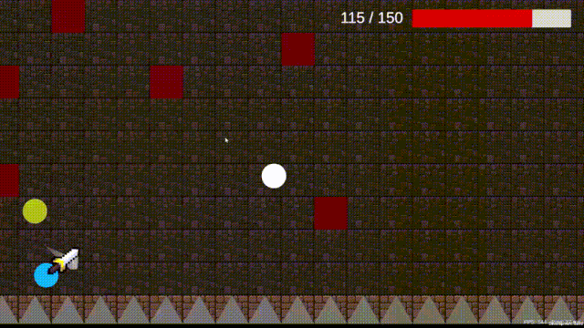
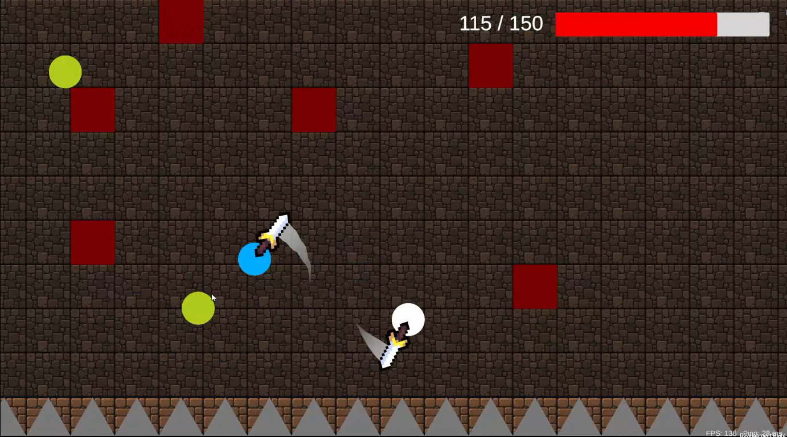
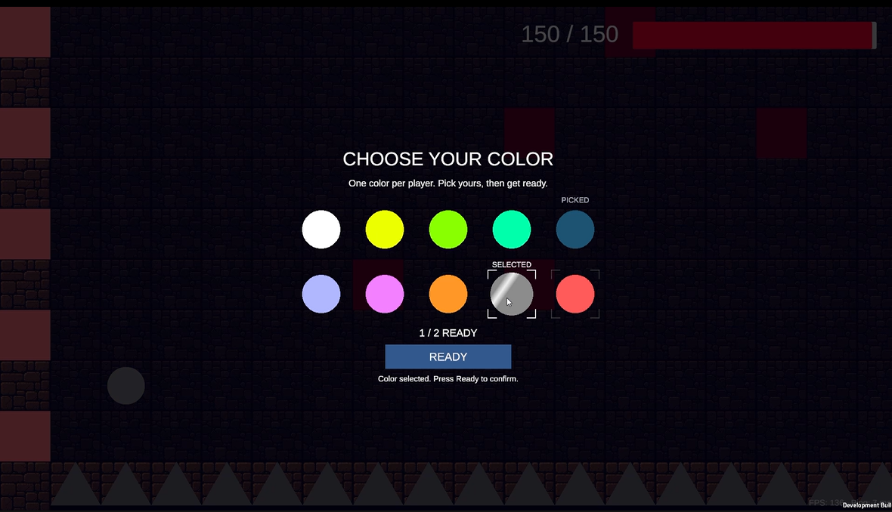
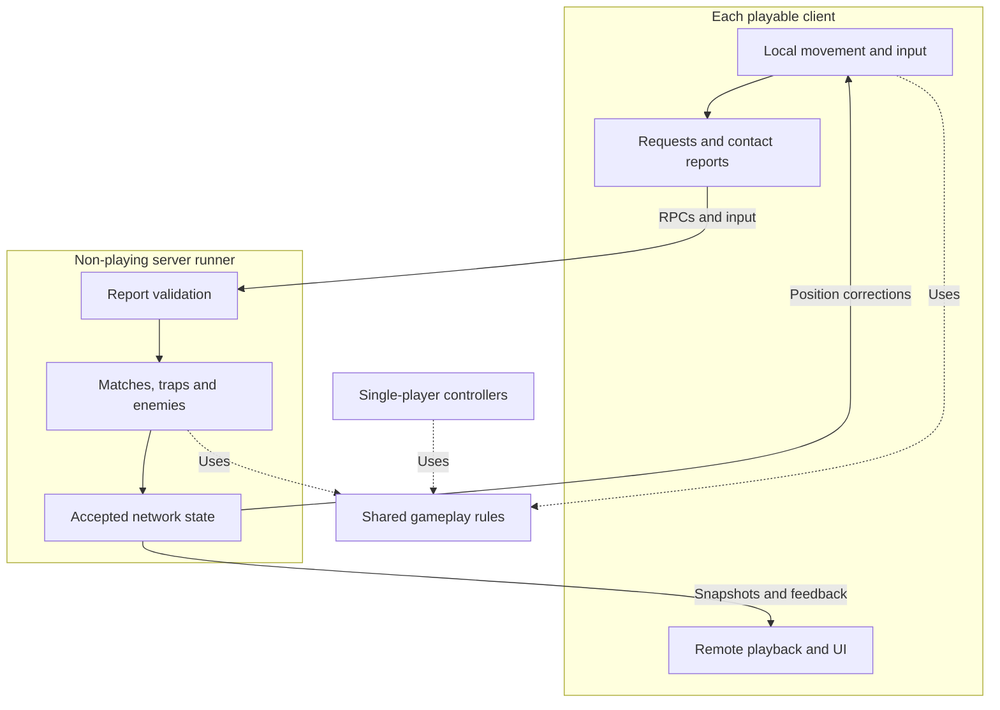

# Panic Dungeon

A 2D dungeon survival game built with **Unity, C#, and Photon Fusion**, combining melee combat, directional traps, zombie enemies, and multiplayer last-player-standing matches.

**Status: In development.** The current multiplayer implementation is on `feature/multiplayer`. Three-player playtesting has been reported as successful by the developer; the configured ten-player capacity is not a validated performance claim.

Panic Dungeon explores a practical networking challenge: keeping player control responsive while making moving traps, damage, and remote-player presentation agree closely enough to feel fair. The project combines shared single-player gameplay components with multiplayer-specific synchronization and authority handling.

## Gameplay preview



Two players fight in the dungeon arena while zombies and directional traps add pressure.



<details>
<summary>Character selection preview</summary>



Players reserve distinct colors before the match. Taken colors are marked PICKED; the ready count tracks progress toward the countdown.

</details>

These captures show the current development build, not final artwork or a finished release. No downloadable release is advertised here.

## Contents

- [Gameplay preview](#gameplay-preview)
- [Gameplay and controls](#gameplay-and-controls)
- [Technical highlights](#technical-highlights)
- [Architecture](#architecture)
- [Technology and project structure](#technology-and-project-structure)
- [Setup and building](#setup-and-building)
- [Multiplayer testing](#multiplayer-testing)
- [Testing and validation](#testing-and-validation)
- [Development status and roadmap](#development-status-and-roadmap)
- [Contributions and AI assistance](#contributions-and-ai-assistance)
- [Assets, credits, and licensing](#assets-credits-and-licensing)

## Gameplay and controls

Move through a confined dungeon arena, dash away from danger, swing a sword at enemies, and respond to trap warnings before they become attacks.

- **Single-player:** survive a timed round while avoiding traps and zombies. Death ends the round; surviving the timer wins it.
- **Multiplayer PvP:** join a room, choose a unique character color, and ready up. After the countdown, survive both opponents and the arena. There is no match time limit: the last living player wins, or the match is a draw if nobody survives.
- **Arena:** a generated tile-based room with non-overlapping obstacle placement. Single-player supports randomized layouts; the multiplayer scene currently uses a fixed room seed so peers generate matching geometry.
- **Traps:** top and bottom spike patterns, left and right arrow patterns, warning indicators, and poison arrows. Difficulty increases by reducing configured trap/warning and enemy-spawn intervals toward minimum values.
- **Zombies:** pursue living players, switch targets when another is meaningfully closer, attack within range, and darken/fade after death.
- **Player identity:** locally remembered display names, networked lobby names and overhead nameplates, ten exclusive color choices, animated selection feedback, and a shared ready count. Names allow up to 16 letters/numbers, spaces, `_`, and `-`; duplicates are allowed and names are not authenticated accounts.
- **PvP placement and collision:** padded, spread-out starting positions; players and zombies can pass through one another physically. Walls, obstacles, and spikes remain relevant to collision, while explicit combat checks still apply damage.
- **Feedback:** damage flashes, dash particles, poison status, local camera feedback, health UI, and an FPS/ping readout.

| Action | Default binding |
| --- | --- |
| Move | WASD or arrow keys |
| Dash | Space or Left Shift |
| Aim | Mouse position |
| Sword attack | Left mouse button |
| Choose color / ready / UI actions | Mouse click |

Bindings are defined in [PlayerControls.inputactions](Assets/Input/PlayerControls.inputactions). Editor Runner Controls select which local peer receives input; that is a testing tool, not a gameplay control.

## Technical highlights

### Responsive movement with bounded server validation

The owning client directly runs the existing movement and dash components. [NetworkPlayerMovementSync](Assets/Scripts/Multiplayer/Players/NetworkPlayerMovementSync.cs) periodically reports position, dash information, a sequence number, and correction generation to the server. Its source default is 30 reports per second; this is a reporting cadence, not a rendering frame-rate limit.

The server checks report order, timestamps, finite coordinates, gameplay permissions, a capped travel allowance, and swept circle collision against configured walls/obstacles. It publishes accepted positions or issues a correction. Other clients interpolate accepted positions from Fusion snapshot buffers.

**Trade-off:** this is client-driven movement with plausibility validation, not full server replay of every input or a cheat-proof movement system. Explicit corrections can still be visible. Remote interpolation and local responsive control serve different purposes.

### Matching trap contact to visible gameplay

The owner's player is controlled locally, while remote traps are displayed from network state. A server contact against an older player position can therefore disagree with what that player sees.

The arrow and spike reporters submit visible-contact evidence. The server validates the sender, timing, movement references, and recorded trap geometry before applying damage. Shared helpers avoid duplicating geometry and history rules between trap types.

Important implementations:

- [NetworkPlayerArrowHitReporter](Assets/Scripts/Multiplayer/Traps/Contact/NetworkPlayerArrowHitReporter.cs) and [NetworkPlayerSpikeHitReporter](Assets/Scripts/Multiplayer/Traps/Contact/NetworkPlayerSpikeHitReporter.cs)
- [PolygonContactDetector](Assets/Scripts/Combat/PolygonContactDetector.cs), [ContactHistory](Assets/Scripts/Combat/ContactHistory.cs), and [ContactRenderSample](Assets/Scripts/Multiplayer/Traps/Contact/ContactRenderSample.cs)
- [NetworkArrow](Assets/Scripts/Multiplayer/Traps/NetworkArrow.cs) and [spike state handling](Assets/Scripts/Multiplayer/Traps/NetworkTrapDirector.Spikes.cs)

<details>
<summary>Contact workflow, observer previews, and limitations</summary>

1. The server simulates traps and publishes state; clients display their local playback.
2. A player's client checks contact against its own visible player, including movement between adjacent samples.
3. Its report identifies trap snapshot samples and player movement evidence. These describe different timelines; they are not assumed to be the same instant.
4. The server checks ownership, report freshness, correction generation, movement plausibility, and historical contact geometry. Missing evidence can be awaited briefly, then rejected rather than invented.
5. Accepted damage changes server-owned health. Confirmation drives the existing health and damage-feedback systems.
6. Other viewers can make a provisional presentation decision: hide an arrow or temporarily hold a spike at observed contact. These previews do not authorize damage.

[TrapContactPreview](Assets/Scripts/Multiplayer/Traps/Contact/TrapContactPreview.cs) shares preview lifetime/target rules. [Arrow observers](Assets/Scripts/Multiplayer/Traps/NetworkArrow.Observers.cs) and [spike observers](Assets/Scripts/Multiplayer/Traps/NetworkTrapDirector.SpikeObservers.cs) implement the different visual responses. Rejection or timeout releases a preview; an arrow may reappear and a spike may require a correction.

Spike previews hold the whole local spike, including its body, rather than an independently delayed sprite. This can affect local collision; proximity checks limit interference with the observing player's own contact handling.

This is **client-observed, server-validated contact**. A modified victim can withhold reports. It is not conventional full-world rollback, a universal lag-compensation solution, or a guarantee that every viewer sees identical contact timing. Geometry assumptions and history retention also limit which reports can be reconstructed.

</details>

### Shared gameplay, separate orchestration

Single-player gameplay helpers remain independent of Fusion. Multiplayer components coordinate authority and replication around reusable behaviour rather than copying every calculation.

- [PlayerMovementMotion](Assets/Scripts/Player/PlayerMovementMotion.cs): movement acceleration/deceleration and dash-curve calculations.
- [SwordSwingMotion](Assets/Scripts/Combat/SwordSwingMotion.cs): shared sword-motion calculations.
- [ZombieRules](Assets/Scripts/Enemies/ZombieRules.cs): pursuit, attack range/cooldown, and target-switch rules.
- [ZombieDeathVisual](Assets/Scripts/Enemies/ZombieDeathVisual.cs): common death tint and fade presentation.
- [StatusEffectTimer](Assets/Scripts/Traps/StatusEffects/StatusEffectTimer.cs): shared status-effect timing used with mode-specific time/authority handling.
- [TrapController](Assets/Scripts/Traps/TrapController.cs): shared trap execution, with [SinglePlayerTrapDirector](Assets/Scripts/Traps/SinglePlayerTrapDirector.cs) and [NetworkTrapDirector](Assets/Scripts/Multiplayer/Traps/NetworkTrapDirector.cs) providing separate orchestration.

### Server-managed enemies, matches, and player selection

[NetworkEnemy](Assets/Scripts/Multiplayer/Enemies/NetworkEnemy.cs) chooses the nearest living player, but retains its current target unless a challenger is closer by a configurable margin. This prevents rapid switching when two players are nearly equidistant. Damage uses server-side range/cooldown checks and an obstruction linecast. Movement is direct pursuit, not pathfinding around obstacles.

[NetworkMatchManager](Assets/Scripts/Multiplayer/Match/NetworkMatchManager.cs) controls color reservations, readiness, countdown, victory, and restart authorization. Clients request changes; the server checks the sender and current state. Disconnecting players release their colors, and active-player health determines the match outcome.

[PlayerSpawnRules](Assets/Scripts/Game/PlayerSpawnRules.cs) selects spread-out positions from safe candidates: first far from the center, then repeatedly maximizing distance to the nearest reserved spawn. [GameSetup](Assets/Scripts/Game/GameSetup.cs) supplies candidates with collider clearance and wall padding. This is a greedy spacing strategy, not a globally optimal placement solver.

## Architecture

All human players use client runners. The room creator's application also runs a separate, non-playing `GameMode.Server` runner. The server is **not a deployed cloud game-server service**; closing that application currently ends the session. A lobby leader is a client with permission to request start/restart, not automatically the server itself.

The diagram shows logical component responsibilities, not separate deployed services. Dotted links mean shared code usage.



| Responsibility | Owner / implementation |
| --- | --- |
| Immediate player movement | Owning client, `PlayerMovement` / `PlayerDash` |
| Accepted movement and corrections | Server, `NetworkPlayerMovementSync` |
| Remote-player presentation | Each observing client, Fusion snapshot interpolation |
| Match state, readiness, victory | Server, `NetworkMatchManager` |
| Trap scheduling and enemy simulation | Server, `NetworkTrapDirector` / `NetworkEnemy` |
| Remote player's visible trap-contact report | That player's client, validated by the server |
| Health and poison damage | Server, `NetworkHealth` and its poison implementation |
| Provisional contact previews | Each viewing client; no damage authority |
| Camera, local HUD, input selection | Local client; runner-scoped bindings |

<details>
<summary>Session lifecycle and component connections</summary>

1. **Create/join:** [MainMenuUI](Assets/Scripts/UI/MainMenuUI.cs) collects a room code and create/join choice. [NetworkSessionBootstrap](Assets/Scripts/Multiplayer/Session/NetworkSessionBootstrap.cs) consumes that request and starts the server-plus-client flow or connects a client. [NetworkLauncher](Assets/Scripts/Multiplayer/Session/NetworkLauncher.cs) now only presents loading and the waiting lobby in MultiplayerSandbox; it no longer owns Create/Join controls.
2. **Lobby:** [NetworkLobbyManager](Assets/Scripts/Multiplayer/Session/NetworkLobbyManager.cs) tracks membership and spawned-player readiness. A leader requests Start; server-side checks authorize the scene transition.
3. **Scene setup:** `GameSetup` generates the arena, configures bounds, and places spawn markers. [NetworkPlayerSpawner](Assets/Scripts/Multiplayer/Players/NetworkPlayerSpawner.cs) discovers ordered markers and spawns/registers player objects on the server.
4. **Selection:** `NetworkMatchManager` reserves unique colors and accepts ready requests. Everyone must be ready, with the minimum player count satisfied, before the countdown begins.
5. **Play:** [NetworkPlayerGameplayGate](Assets/Scripts/Multiplayer/Players/NetworkPlayerGameplayGate.cs) gates player action. The server runs traps/enemies; clients move locally and exchange input/reports/state with the server.
6. **Feedback:** [NetworkHealth](Assets/Scripts/Multiplayer/Combat/NetworkHealth.cs) separates authoritative health changes from presentation. Local UI/camera binders select the correct player and runner. Sword contact can preview a zombie flash without predicting its death or changing HP.
7. **End/restart:** the server declares the remaining living player the winner, or a draw at zero survivors. The current leader can request a scene reload after match over.

Single-player uses [RoundManager](Assets/Scripts/Game/RoundManager.cs) and local health instead of the network match lifecycle. Its survival timer is separate from multiplayer's elimination-only rules.

Leader replacement currently chooses a remaining low-index `PlayerRef`; it does not implement strict persistent join-order succession or transfer the server to another computer.

</details>

## Technology and project structure

| Technology | Verified version | Role |
| --- | --- | --- |
| Unity Editor | 6000.5.3f1 | Engine, editor, 2D physics and builds |
| C# | Unity project scripts | Gameplay, networking adapters, reusable rules |
| Photon Fusion | 2.1.1; bundled runtime 2.1.1.2177 | Runners, RPCs, replicated state, network objects and snapshots |
| Universal Render Pipeline | 17.5.0 | 2D rendering |
| Unity Input System | 1.19.0 | Input actions and devices |
| Cinemachine | 3.1.7 | Camera components |
| Unity UI / TextMeshPro | uGUI 2.5.0 | Menus, HUD and runtime selection UI |
| Unity Tilemaps | Project package configuration | Room floor/wall construction |
| Git / GitHub | Not version-pinned | Source history and project presentation |

Version sources: [ProjectVersion.txt](ProjectSettings/ProjectVersion.txt), [manifest.json](Packages/manifest.json), and the bundled Fusion runtime. Not every installed Unity package represents an implemented gameplay feature.

```text
Assets/
  Scripts/
    Player/       Local movement, dash, combat and tuning
    Combat/       Damage contracts, health, geometry and shared visuals
    Enemies/      Local AI, shared enemy rules and tuning
    Traps/        Trap execution, difficulty and status effects
    Multiplayer/  Authority, replication, session flow and presentation
    Game/         Room generation, spawn rules, rounds and cameras
    UI/           Menus, HUD and selection graphics
    Audio/        Audio playback
    Utilities/    Layer definitions, validation and spawn clearance
  Scenes/         Single-player and multiplayer entry/game scenes
  Prefabs/        Player, zombie, projectile and trap templates
  Photon/         Bundled Photon SDK
Packages/         Unity dependency declarations
ProjectSettings/  Editor, build and project configuration
Tests/            Standalone checks and manual feature test notes
Docs/Media/       Gameplay screenshots and recording
```

## Setup and building

### Prerequisites

- Unity Hub and **Unity 6000.5.3f1**, with the build-support modules required for your chosen Windows build backend.
- A Photon account and a **Fusion App ID** for multiplayer. Use your own development configuration; do not depend on a repository contributor's service configuration.
- Internet access for package restoration and Photon multiplayer connections.
- Optional: a **.NET 8 or newer SDK** to run the standalone checks below.

### Open the project

1. Clone the repository and select the multiplayer branch:

   ```powershell
   git clone --branch feature/multiplayer https://github.com/NNC21July/panic-dungeon.git
   cd panic-dungeon
   ```

2. Add the cloned project folder in Unity Hub and open it with the recorded editor version. Allow package restoration and asset import to finish.
3. Confirm there are no compilation/import errors before entering Play mode. Fusion is bundled under `Assets/Photon`; do not import a second conflicting SDK copy.
4. For multiplayer, locate the `PhotonAppSettings` asset in the Project window and configure its **App Id Fusion** with your own Fusion App ID. All test peers must use compatible Photon configuration and matching game code. Do not publish authentication tokens, private credentials, or screenshots containing private configuration.
5. Keep the Fusion `NetworkProjectConfig` **Peer Mode = Multiple** for the current room-creation architecture. Its configured player capacity is ten.

### Choose an entry scene

- **Player entry:** open [MainMenu](Assets/Scenes/MainMenu.unity). Play opens Create/Join; either choice opens the room-code panel with the matching submit label. Submitting hands the connection request to [MultiplayerSandbox](Assets/Scenes/MultiplayerSandbox.unity), which remains the connection/lobby scene. The leader's Start Game request loads [MultiplayerGame](Assets/Scenes/MultiplayerGame.unity).
- **Single-player testing:** open [Game](Assets/Scenes/Game.unity) directly. The main menu's Play button now enters multiplayer rather than single-player.
- **Multiplayer editor testing:** opening `MultiplayerSandbox` directly retains its existing multi-peer development workflow.

The room-code panel displays validation warnings and restores the previous code/mode with an error message after connection failure. Sessions entered through MainMenu return there when leaving/disconnecting. Opening `MultiplayerGame` by itself does not replace runner/lobby startup. The new menu flow still needs Unity runtime validation.

### Build and run

1. Open Unity's Build Profiles and select the intended **Windows player** target. Check the profile/subtarget and installed support modules rather than assuming every saved local profile is ready for distribution.
2. Verify the enabled scene list contains `MainMenu`, `MultiplayerSandbox`, `Game`, and `MultiplayerGame`. The current global list places `MainMenu` first. Rebuild all test peers together after scene-list changes.
3. Build into a separate output folder such as `Builds/MultiplayerTest`. Close running copies before rebuilding into that folder to avoid locked-file errors.
4. Copy the **entire build output folder** to another Windows computer, not just the `.exe`.
5. Run matching builds. Standalone startup uses manual Create Room / Join rather than automatically launching the editor's multi-peer test preset.

This documents the intended workflow from the checked configuration. A fresh clean-checkout build was not performed for this README. No macOS, Linux, mobile, or WebGL build support is claimed as validated.

## Multiplayer testing

### Two or more computers

1. On one computer, enter a room code and choose **Create Room**. That application runs both the server and the creator's client.
2. On another, enter the same code and choose **Join**. Join all intended players before starting the match.
3. The lobby shows the room code, player count, and roster with **You** / **Leader** labels. Only the leader sees **Start Game**, enabled once enough players have spawned.
4. Each player selects an available color and presses **Ready**. The countdown begins when everyone is ready.
5. Play through elimination and have the leader restart after match over.

Room admission closes when the game starts. Mid-match reconnect and host/server migration are not provided. Keep the creator's application running; a leader label transferring between clients does not keep a stopped server alive.

**Leave Room / Leave Game** opens a confirmation. A guest leaves without closing the room; the computer running the server closes the session for everyone. The application returns to Create/Join, not to the desktop. A graceful creator exit displays a room-closed notice; an abrupt disconnect displays a generic connection-loss message. Failed connections also return to Create/Join for another attempt.

This session UI/cleanup change has passed static compilation, but still needs Unity play-mode and multi-computer validation: check guest leave, creator leave, failed join followed by retry, and repeated create/leave cycles. In editor multi-peer testing, Close Local Session shuts down all runners owned by that bootstrap; use separate applications to test an independent guest leaving.

### Unity multi-peer testing

Use `MultiplayerSandbox` and inspect its `NetworkSessionBootstrap` settings before entering Play mode. This project-owned subclass retains Fusion's startup workflow and adds session cleanup. The development preset supports a non-playing server plus multiple local clients; test the player-facing Create/Join flow by starting from MainMenu instead. Its inspector's additional-client controls can add local peers while the room is open. Leaving or disconnecting returns to MainMenu even for editor-started sessions. MultiplayerSandbox contains only a loading panel and the runtime waiting-lobby UI, not a second set of Create/Join controls.

Use **Network Runner Controls** to choose the visible client and the input-receiving client. The server is not a playable avatar. Each peer has its own scene/physics context, so seeing copies of player objects under multiple runners is expected.

Multi-peer testing is convenient for iteration, but does not replace separate-process and separate-computer testing under real network conditions.

<details>
<summary>Practical regression checklist</summary>

- Create/join with valid, blank, and nonexistent room codes; verify start permission and failure feedback.
- Have two players select the same color simultaneously; confirm only one reservation succeeds.
- Disconnect during selection/countdown; verify color release and readiness recalculation.
- Check padded spawn clearance and spacing for several player counts.
- Observe movement, dash VFX, near misses, poison ticks, and enemy damage from both owner and observer views.
- Confirm pass-through between characters without losing sword, arrow, spike, or zombie damage.
- Verify last-player-standing victory, zero-survivor draw, repeated restarts, and cleanup of old effects/objects.
- Repeat with artificial latency/packet loss and separate computers; check preview rejection/timeouts, not just successful hits.
- Recheck the single-player scene after changes to shared code.

</details>

## Testing and validation

**Current evidence:** the developer reports successful three-player playtesting. The report does not establish an exhaustive scenario matrix, network conditions, or a ten-player load result. No FPS, latency, or reliability benchmarks are claimed.

The repository includes standalone checks for polygon/circle contact, history and preview rules, poison timing, enemy rules, character colors, and spread-out spawning.

```powershell
.\Tests\Run-ArrowContactChecks.ps1 -UnityEditor 'D:\Unity Hub\Editor\6000.5.3f1\Editor'
```

Replace the editor path with your installation. The script compiles selected production helpers with a .NET SDK and Unity/Fusion managed assemblies, then executes its checks. Generated output goes under ignored `Temp/ArrowFeatureChecks`.

**These are not end-to-end Unity tests.** They do not exercise Fusion weaving, actual RPC delivery, live physics scenes, rendering, audio, or scene transitions. A static C# compile is also not proof that a Unity build or multiplayer session succeeds. The test suite was not rerun as part of writing this README.

<details>
<summary>Existing feature notes and test entry points</summary>

- [Test runner](Tests/Run-ArrowContactChecks.ps1) and [primary check entry point](Tests/ArrowContactChecks.cs)
- [Arrow contact and observer previews](Tests/ArrowHitFeature.md)
- [Spike contact and observer holds](Tests/SpikeHitFeature.md)
- [Poison timing and feedback](Tests/PoisonFeature.md)
- [Enemy spawning and combat](Tests/EnemySpawningFeature.md)
- [Sword contact feedback](Tests/SwordContactFeedback.md)
- [Character selection](Tests/CharacterSelectionFeature.md)
- [PvP rules and spawning](Tests/MultiplayerPvpRules.md)
- [Original server-lobby checkpoint](Tests/ServerLobbyFeature.md)

These notes include historical checkpoint instructions. In particular, the original lobby note's two-spawn limitation and server-restricted restart description are outdated: current configuration provides ten slots and leader-requested restarts. Older host-player test instructions describe compatibility/testing paths, not the current all-human-players-as-clients startup. Use the current source and this README's topology explanation when interpreting those notes.

</details>

## Development status and roadmap

### Implemented

- [x] Single-player timed survival, local movement/dash, melee combat, traps and zombies.
- [x] Shared gameplay calculations and visual helpers with separate multiplayer orchestration.
- [x] Room-code multiplayer with a non-playing server and playable clients.
- [x] Network spawning, movement reports/validation, corrections, and remote interpolation.
- [x] Server-controlled enemies, trap scheduling, health, poison, and match results.
- [x] Visible trap-contact reporting and bounded observer previews.
- [x] Ten color choices with exclusive reservations and ready confirmation.
- [x] Spread-out PvP spawns, character pass-through, and elimination-only matches.
- [x] Leader restart requests and local FPS/ping display.
- [x] Local spectator camera after elimination, screen-edge previous/next buttons, and a username caption. Targets automatically change when the watched player dies or disconnects; controls hide at match results.

### Ongoing validation and refinement

- [ ] Broader latency, packet-loss, and multi-computer regression coverage.
- [ ] Larger-session testing up to the configured ten-player capacity.
- [ ] Contact/feedback consistency under fast movement and network delay.
- [ ] Clean-checkout build reproducibility and documented runtime test results.
- [ ] Complete asset attribution and licensing verification.
- [ ] Spectator runtime checks with at least three players: eliminate the local player, cycle both directions, eliminate/disconnect the watched player, and restart. Verify results hide the controls, the new match restores your own camera, and switching runner visibility does not mix player views.

### Planned, not implemented

- [ ] Server handoff/migration is deferred; creator departure closes the room instead.

### Known limitations

- The creator's computer is the current session's server dependency; there is no automatic migration or deployed server fleet.
- Victim-reported trap contact improves local visual consistency but introduces a report-withholding trust risk.
- Observer previews can be rejected and visibly corrected; they do not eliminate latency or guarantee matching views.
- Movement checks are bounded plausibility checks, not complete anti-cheat or full input replay.
- Zombie pursuit has no obstacle pathfinding; melee/enemy timing still needs realistic latency evaluation.
- Multiplayer uses matching fixed-seed scene generation rather than transferring arbitrary generated room layouts.
- Session retry and disconnect UI require runtime regression testing; mid-match join/reconnect is not implemented.
- A configured maximum of ten players is not equivalent to ten-player validation.

## Contributions and AI assistance

**Developed by Nathanael Nicolas Chang.** Nathanael directs game design, gameplay and networking requirements, feature integration, tuning, and playtesting, iterating on the implementation based on observed gameplay and player feedback.

**OpenAI Codex assisted with code implementation, debugging, refactoring, and documentation.** This repository is not presented as entirely independently hand-written code. Source links, Git history, documented trade-offs, and testing notes provide evidence of the implementation and its development process.

Collaborator-specific credits will be added when their contributions are confirmed; no artwork collaborator is credited with completed assets without confirmation.

## Assets, credits, and licensing

- **Unity and Unity packages:** engine, rendering, input, camera, UI, and supporting tooling. These remain subject to their respective terms.
- **Photon Fusion and Photon dependencies:** multiplayer middleware bundled under `Assets/Photon`; respective vendor terms apply.
- **OpenAI Codex:** development and documentation assistance as described above.
- **Sound effects:** the developer reports using free samples found online. Original source links, creators, exact file mappings, and redistribution/attribution terms are **not yet verified**. Files are under [Assets/Audio/SFX](Assets/Audio/SFX); this is not a claim that every file there has the same source or license.
- **Artwork and fonts:** a complete source/author/license inventory remains pending. Included assets should not be assumed to be original work or freely redistributable solely because they appear in the repository.

No project-level license was identified during the documentation audit. Public source visibility does not itself grant permission to reuse all code, art, audio, or bundled middleware. Resolve outstanding asset permissions before distributing a public playable build; do not label the whole repository MIT, CC0, or otherwise openly licensed without the appropriate rights and an explicit license.

Gameplay captures are stored under [Docs/Media](Docs/Media). The screenshots and recording document the current build; they do not establish performance benchmarks or resolve the licensing of assets shown in them.
